# NeuroDígitos — Reconocimiento de dígitos manuscritos (0–9) con un perceptrón multicapa

**Curso:** Redes Neuronales · **Actividad:** PA1 — Trabajo de la unidad 1
**Estudiante:** Jhon Elias Aguilar Anccori · Universidad Nacional del Altiplano de Puno

<p align="center">
  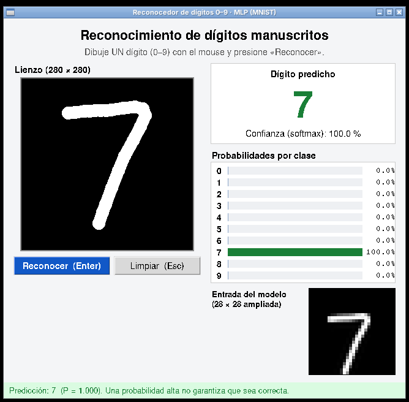
</p>

## ¿Qué hace este proyecto?

NeuroDígitos es un programa en Python que:

1. **Entrena** un **perceptrón multicapa (MLP)** con TensorFlow/Keras sobre el dataset
   **MNIST** (70 000 imágenes de dígitos escritos a mano, 28×28 px).
2. **Evalúa** el modelo en el conjunto de prueba oficial y genera métricas, matriz de
   confusión, curvas de aprendizaje y ejemplos de aciertos/errores.
3. Ofrece una **interfaz gráfica (Tkinter)** en la que el usuario **dibuja un dígito con
   el mouse** y la red lo reconoce, mostrando:
   - el dígito predicho y su confianza,
   - las probabilidades de las 10 clases (barras),
   - la imagen de 28×28 que realmente recibe la red tras el preprocesamiento.
4. Permite **reconocer dígitos desde archivos de imagen** por línea de comandos (`predict.py`).

> **Alcance:** reconoce **un solo dígito por imagen** (0–9). No reconoce números de varias
> cifras, letras ni fotografías arbitrarias.

## Resultados

| Métrica (conjunto de prueba oficial, 10 000 imágenes) | Valor |
|---|---|
| Exactitud | **97,90 %** |
| Pérdida (entropía cruzada) | 0,0710 |
| F1 macro | 0,9788 |
| Errores | 210 de 10 000 |
| Mejor época (EarlyStopping) | 12 de 17 |
| Parámetros entrenables | 109 386 |
| Tiempo de entrenamiento (CPU) | ≈ 35 s |

Los valores pueden variar ligeramente en otra computadora (ver [Reproducibilidad](#reproducibilidad)).

## Capturas

### Interfaz gráfica

| Inicio | Dígito 3 | Dígito 8 |
|---|---|---|
| 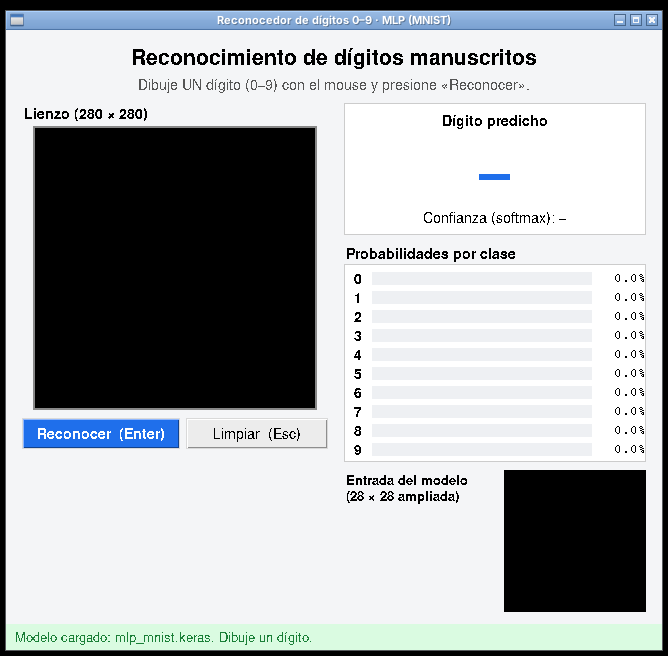 | 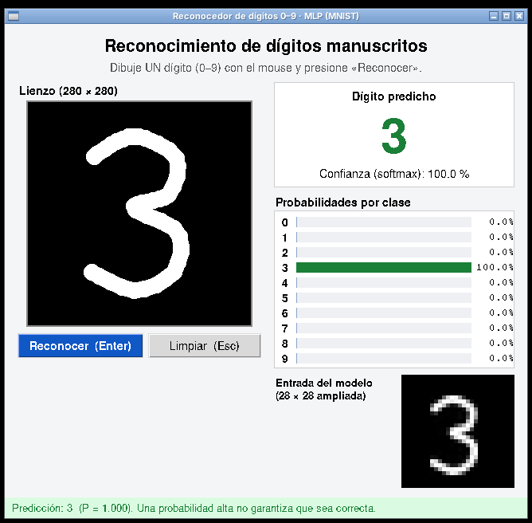 | 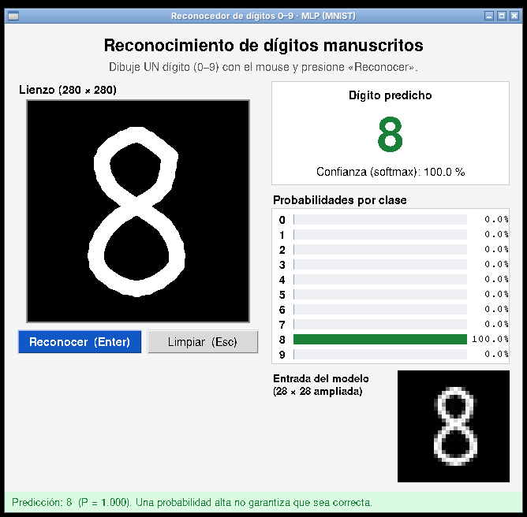 |

| Dígito pequeño en la esquina (se recentra) | Fuera de alcance: «12» | Modelo ausente |
|---|---|---|
| 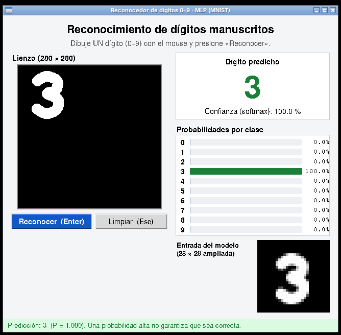 | 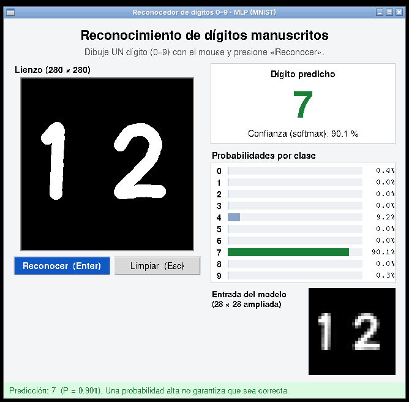 | 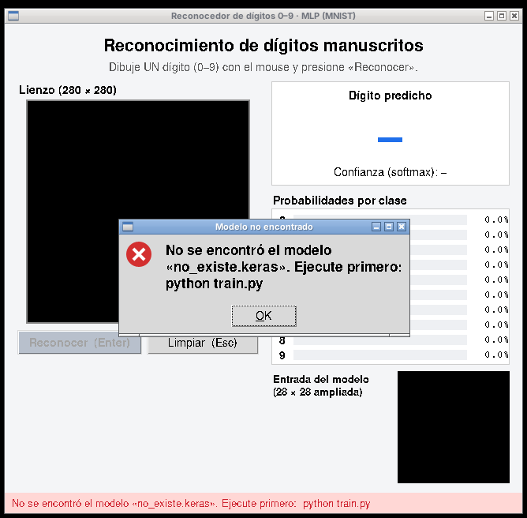 |

Montaje de los 10 dígitos reconocidos en la interfaz:

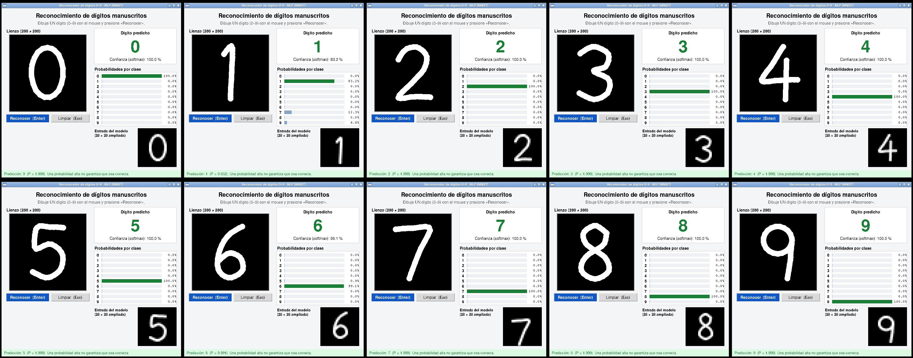

### Entrenamiento y evaluación

| Curvas de aprendizaje | Matriz de confusión |
|---|---|
| 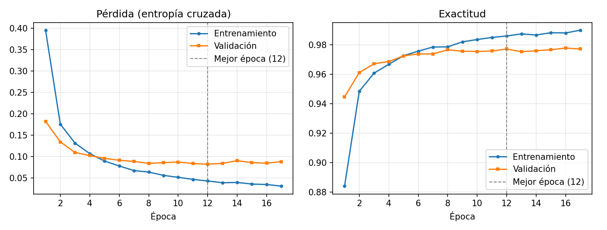 | 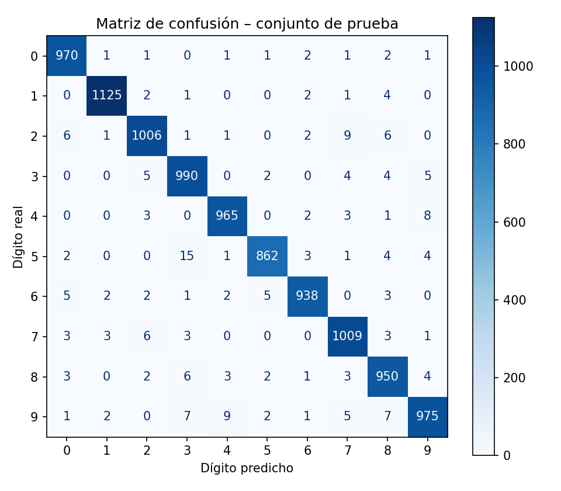 |

| Pipeline de preprocesamiento del dibujo |
|---|
| 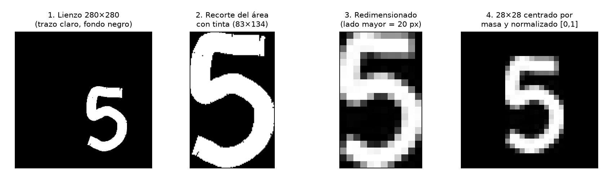 |

| Ejemplos de MNIST | Ejemplos mal clasificados |
|---|---|
| 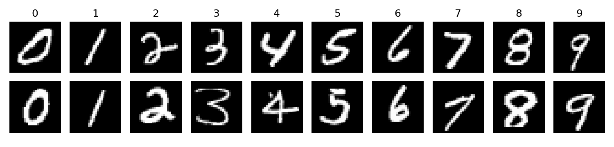 | 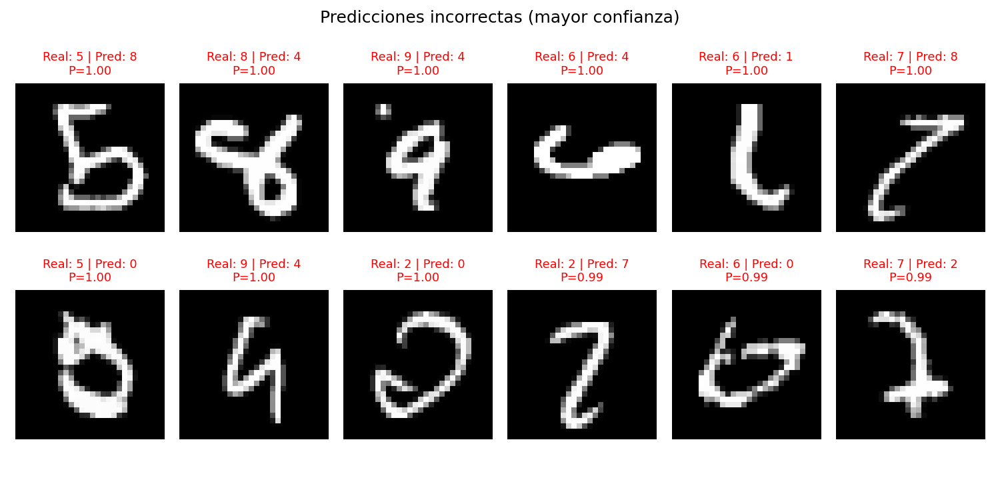 |

## Arquitectura

### Arquitectura de la red neuronal (MLP)

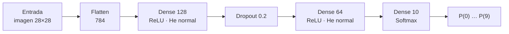

| Hiperparámetro | Valor |
|---|---|
| Optimizador | Adam (lr = 0,001) |
| Pérdida | Sparse categorical cross-entropy |
| Tamaño de lote | 128 |
| Épocas máximas | 50, con EarlyStopping (paciencia 5, restaura mejores pesos) |
| Validación | 10 % del entrenamiento, estratificado (54 000 / 6 000) |
| Semilla | 42 |

Todos los hiperparámetros están centralizados en `digit_recognizer/config.py`.

### Arquitectura del software

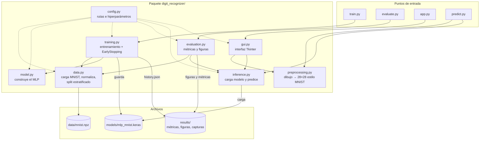

### Flujo de reconocimiento en la interfaz

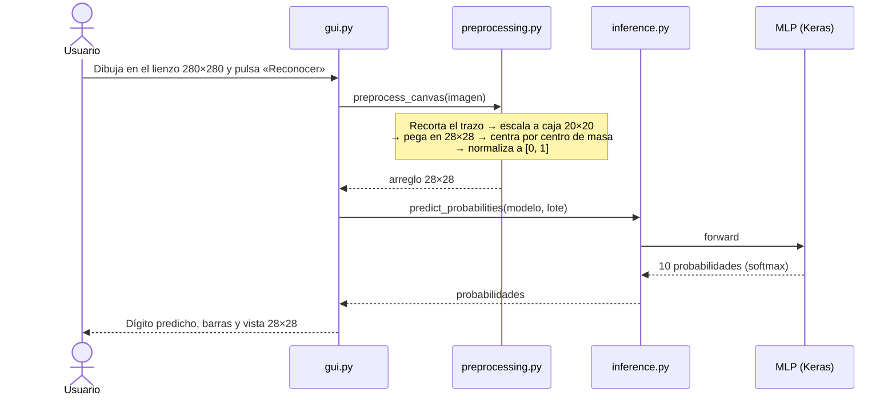

### Estructura de carpetas

```
NeuroDigitos/
├── app.py                    # abre la interfaz gráfica
├── train.py                  # entrena y guarda el modelo
├── evaluate.py               # evalúa en prueba y genera figuras/métricas
├── predict.py                # reconoce un dígito desde un archivo de imagen
├── requirements.txt
├── digit_recognizer/
│   ├── config.py             # rutas e hiperparámetros
│   ├── data.py               # carga de MNIST, normalización, validación estratificada
│   ├── model.py              # arquitectura del MLP
│   ├── training.py           # entrenamiento con EarlyStopping
│   ├── evaluation.py         # métricas, matriz de confusión, curvas
│   ├── preprocessing.py      # dibujo -> imagen 28x28 estilo MNIST
│   ├── inference.py          # carga del modelo y predicción
│   └── gui.py                # interfaz Tkinter
├── tests/
│   ├── test_project.py       # pruebas automáticas (pytest)
│   └── test_regressions.py   # pruebas de regresión (unittest)
├── scripts/                  # capturas automáticas (Linux) y figuras del informe
├── data/mnist.npz            # copia local de MNIST
├── models/mlp_mnist.keras    # modelo entrenado (incluido)
└── results/                  # métricas (.json/.txt), figuras y capturas
```

## Paso a paso: instalación y ejecución

### Requisitos

- **Python 3.12 o 3.13** (64 bits). En Windows, el instalador oficial de
  [python.org](https://www.python.org/downloads/) ya incluye **Tkinter**.
- **Git** (para clonar el repositorio).
- ~1,5 GB libres para TensorFlow.

### 1. Clonar el repositorio

```bash
git clone https://github.com/Jhony410/NeuroDigitos.git
cd NeuroDigitos
```

### 2. Crear el entorno virtual e instalar dependencias

**Windows (PowerShell):**

```powershell
python -m venv .venv
.\.venv\Scripts\python.exe -m pip install --upgrade pip
.\.venv\Scripts\python.exe -m pip install -r requirements.txt
```

**Linux / macOS:**

```bash
python3 -m venv .venv
source .venv/bin/activate
pip install --upgrade pip
pip install -r requirements.txt
```

> En Linux, si falta Tkinter: `sudo apt install python3-tk`.

### 3. Abrir la interfaz gráfica (`app.py`)

El modelo entrenado ya está incluido en `models/mlp_mnist.keras`, así que **no es
necesario entrenar** para usar la aplicación:

```powershell
# Windows
.\.venv\Scripts\python.exe app.py
```

```bash
# Linux / macOS (con el entorno activado)
python app.py
```

Uso de la ventana:

| Acción | Cómo |
|---|---|
| Dibujar | Mantener el botón izquierdo del mouse sobre el lienzo negro |
| Reconocer | Botón **Reconocer** o tecla **Enter** |
| Limpiar | Botón **Limpiar** o tecla **Esc** |

A la derecha se muestran el dígito predicho, la confianza, las probabilidades de cada
clase y la imagen 28×28 que recibe la red.

### 4. (Opcional) Reentrenar el modelo

```powershell
python train.py               # entrena (≈ 1 min en CPU) y guarda models/mlp_mnist.keras
python train.py --epochs 5    # prueba rápida
python train.py --evaluate    # entrena y luego evalúa
```

> Reentrenar sobrescribe el modelo y los resultados de `results/`.

### 5. (Opcional) Evaluar y generar figuras

```powershell
python evaluate.py
```

Genera `results/test_metrics.json`, `results/classification_report.txt` y las figuras en
`results/figures/`.

### 6. (Opcional) Reconocer desde un archivo de imagen

```powershell
python predict.py imagen.png
```

Devuelve un JSON con el dígito y las diez probabilidades. Use un único dígito aislado,
con fondo uniforme y buen contraste. Los PNG transparentes se componen sobre blanco.

### 7. (Opcional) Ejecutar las pruebas

```powershell
python -m pytest -v
python -m unittest discover -s tests -p test_regressions.py -v
```

> En Windows, sustituya `python` por `.\.venv\Scripts\python.exe` si no activó el entorno.

## Sobre los datos

Si existe `data/mnist.npz` se usa esa copia local. Si se borra, Keras descarga MNIST
automáticamente la primera vez (requiere internet) y lo guarda en `~/.keras/datasets`.

## Reproducibilidad

Se fija la semilla 42 (Python, NumPy y TensorFlow) y se activa el determinismo de
operaciones. Aun así, otro sistema operativo, otro procesador/GPU o versiones distintas
de las librerías pueden producir diferencias pequeñas en los números finales. El
experimento original usó Python 3.12 / TensorFlow 2.19.1; la revisión en Windows usa
Python 3.13 / TensorFlow 2.21.0. Las métricas guardadas incluyen fecha, entorno y SHA-256
del modelo.

## Capturas automáticas (solo Linux)

`scripts/capture_screenshots.py` mueve el mouse real con `xdotool` sobre un servidor
gráfico virtual (Xvfb) para dibujar los dígitos 0–9 y guardar capturas. En Windows basta
con usar `python app.py` y dibujar a mano.
